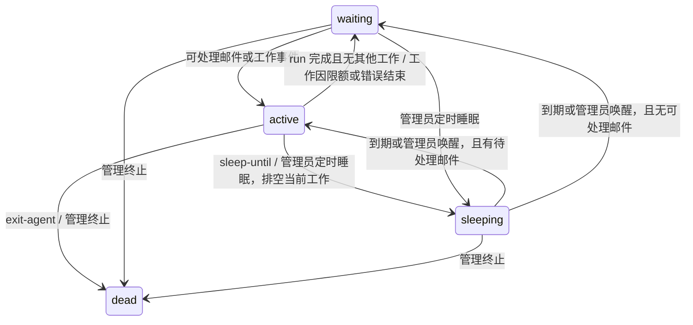

# 成员四态调度与邮件解耦

状态：已实现（2026-10-18），执行边界于 2026-10-24 按 [ADR 0049](../decisions/0049-retire-agent-session.md) 更新。决策见 [ADR 0039](../decisions/0039-four-state-scheduling.md) 和 [ADR 0041](../decisions/0041-admin-scheduling-controls.md)。

## 1. 状态定义

成员对外只有四种调度状态。状态由 runtime 维护，成员通过工具、管理员通过管理接口请求转换，不直接写状态字段。

| 状态 | 含义 | 收到邮件 | 是否执行成员工作 |
|---|---|---|---|
| 活跃 `active` | 正在处理工作，包括 LLM 调用、工具执行和结果收集 | 正常入箱，按成员程序与串行事件队列后续处理 | 是 |
| 等待 `waiting` | 当前没有工作，等待可处理的邮件或已声明的工作事件 | 正常入箱；符合行为规则的来信使其活跃 | 否，直到发生工作事件 |
| 睡眠 `sleeping` | 成员或管理员请求睡到指定时刻，期间不处理邮件或运行成员工作 | 正常入箱，不提前唤醒 | 否 |
| 死亡 `dead` | 永久停止响应；不是进程暂时离线 | 拒收新邮件 | 否，终态 |

“活跃”覆盖等待 LLM 网络响应、等待工具结果的时间。program run 可以包含多个局部 turn，但不得把内部 I/O waiting 当作成员的“等待”。没有后台反思；成员显式调用模型或文件工具的记忆整理属于普通工作。计时、邮箱入箱和日志维护属于 runtime 工作，不使成员变为活跃。

运行实例装配、卸载、启动中、出错、服务离线等是运行诊断，不再与四态混作一组枚举。等待中的成员可以驻留或卸载；卸载不意味着睡眠。runtime 整体离线不意味着全部成员死亡。

## 2. 状态转换

- 收到不符合成员行为规则的邮件不必进入活跃；可沿用已有门控与标读语义。
- 活跃时新来信仍入箱，不并发创建第二个 program run。工作结束后如有新接纳的邮件，可以立即再次活跃。
- 睡眠期间的邮件和普通事件均不能绕过睡眠门控；不积攒重放所有普通事件。已有邮件保存在邮箱，到期后按成员规则检查。
- 睡眠到期先检查持久邮箱：有可处理邮件则处理，否则等待。到期和管理员提前唤醒本身均不调用 LLM。
- 结束、睡眠、退出不隐式标读。沿用责任集与慢速重扫规则，避免 finish-turn 后立即反复处理同一批搁置邮件；睡眠到期可重新检查这些未读邮件。
- 无效或已过期的睡眠时间拒绝，状态不变。暂不提供无限期睡眠和普通邮件提前唤醒。
- 死亡后不再以成员身份调用工具或发送告别邮件；系统只读归档清点不恢复成员。死亡不可通过来信、到期、start/reload、服务重启或管理员“启动”复活。人格、记忆、邮件和 journal 保留；历史删除是另一个明确管理动作。

## 3. 工具职责

| 工具 | 职责 | 对调度的影响 |
|---|---|---|
| `mail-send(to, content, ...)` | 发送邮件，返回真实投信结果 | 无；删除 `is_complete` 参数 |
| `mail-forward(...)` | 转发邮件 | 无 |
| `mail-check-inbox` / `mail-search` | 查询自己的邮箱 | 无 |
| `mail-mark-read(mail_ids)` | 标读自己的邮件 | 影响以后哪些邮件可触发工作；不直接转换当前状态 |
| `finish-turn()` | 结束所属局部行动 turn，不发送邮件 | 外层程序继续；仅当 run 与其他工作全部结束后进入等待 |
| `sleep-until(wake_at, reason?)` | 结束本次工作，睡至指定 UTC 时刻 | 活跃 → 睡眠 |
| `exit-agent(reason?)` | 自己永久退出，保留历史 | 活跃 → 死亡 |
| `member-self-state()` | 读取自己的状态、唤醒时间、待退出等诊断信息 | 无 |

上述状态工具只操作调用者自身；退休其他成员属于单独的管理权限，不由“正式成员身份”默认授予。旧 member-stop 已删除；管理端通过 POST /admin/agents/{agent_id}/terminate 请求排空后死亡，不提供普通成员可调用的同等工具。

三个结束类调用必须单独占据一个工具调用轮次，不能与发信、文件写入或其他工具并发。runtime 必须确认本轮其他成员工作与已派发工具完成，再提交转换；不接受“先关掉自己，再等待自己的工具返回”。不允许睡眠后继续普通模型调用。

推荐的交互序列：

1. `mail-mark-read(...)`：明确标记已处理的信。
2. `mail-send(...)`：发送必要回复，检查投递结果，失败时可处理失败。
3. 下一轮调用 `finish-turn()`、`sleep-until(...)` 或 `exit-agent()`，明确表达后续调度意图。

这会比现有 `mail-send(is_complete=true)` 多一次模型工具调用轮次，是解耦的成本。本轮不预设批处理或“发信后自动 finish”的隐藏优化。可以发多封邮件后结束，也可以完全不发信直接结束或睡眠。删除 `silence`，由 `finish-turn` 承担不回信结束工作的语义，不保留别名。

业务任务的 `task-pause` / `task-complete` 只改变任务记录，不代表成员睡眠或本次 program run 结束；继续保持独立。

## 4. 邮件与调度的关系

解耦指职责分开，不表示没有事件联系：投递提交后产生通知，调度器根据成员状态决定是否接纳工作；标读改变未来的待处理集合。

- 邮局负责地址、幂等、原子入箱与拒信。睡眠和等待都正常收信；死亡拒收。一封多人邮件若含死亡收件人，沿用当前整封拒绝契约。
- 调度器负责何时处理邮箱、何时睡、何时结束。发信成功只表示入箱，不表示自己的工作已经完成或对方已处理。
- `finish-turn` 只结束所属局部行动循环，不保证整个 program run、业务任务或邮箱处理完成。外层程序可继续执行、进入另一 turn，最后提交 run 结果与调度意图。
- 资源回收不设置 sleeping。旧 idle drain 应改为卸载等待中的实例；睡眠期限只能由显式睡眠意图决定。
- 错误、超时或预算耗尽结束当前工作，不自动判定死亡。已有错误通知可由明确的系统通知政策发送，不能重新把邮件工具当作结束信号。

## 5. 状态的权威、持久化与竞争

需要持久保存死亡标记和睡眠期限；活跃与等待依据真实工作派生，不能靠一个上次写入的 active 字符串判定。一个成员有唯一的生命周期读写入口，工具、REST、DSL、启动恢复和邮件补偿共用它。

复用实例现有 SQLite 基础设施，保持死亡提交与本地入箱的事务排序，避免“查到未死亡后又给已死亡成员入箱”的竞态；生命周期 API 与邮件 API 保持职责分开。具体表结构与事务接口在实施前细化，不新增第二份死亡事实源。

睡眠请求在完成当前工作后持久记录绝对 UTC 唤醒时刻，再由 runtime 管理计时。重启不会延长睡眠：未来期限继续等待；已到期则检查邮箱。睡眠闸门同时约束投递通知、启动扫描、慢速重扫、链式唤醒和所有规则程序，不能仅在某一个入口判断。

runtime 只由 ProgramStore 恢复未完成 program run，不从 RunJournal 的历史投影或已完成 run 重新制造工作。睡眠在当前工作全部排空后提交，持久睡眠期间不能继续执行成员 run。`is_busy` 覆盖程序执行与后台维护；后台维护不算 program run 数量。

状态变更写入可追踪的原因与时间；到期回调必须重新读状态，防止旧计时器唤醒已经死亡或改变了睡眠期限的成员。死亡与睡眠的改变由同一成员锁串行化。管理等待、睡眠与终止活跃成员均先阻止新工作接纳、排空当前工作，不能只改一个显示字段；不强制取消正在执行的 LLM 或工具。

## 6. 当前执行与读侧边界

ADR 0039/0041 的四态、持久睡眠与管理排空已实现；其中旧 session 引擎、scheduler 和 stage 路径由后续模块程序设计替代，ADR 0049 正式删除 agent session 实体及旧历史读取，不保留别名、兼容层或 migration。历史决策仍保留在对应 ADR 中。

- `agents/member_runtime.py` 串行运行成员程序；`is_busy` 同时覆盖程序与后台维护，排空等待全部活动结束。
- ProgramStore 保存 run 输入、预算、调用回执、完成与失败结果，拥有唯一执行恢复权威；RunJournal 只提供 run 历史读取、清单和导出。
- 笔记可引用原始 `run_id`，历史回顾也使用原始 `run_id`；派生额度键为 `(spawner_id, run_id)`，成员配置为 `run_spawn_quota`。
- serving 层 client session 继续承担连接、身份和 SSE 订阅，`/sessions` 客户端协议不变。
- 不修改用户磁盘上的旧 agent session 归档，不迁移旧来源引用；旧历史不再可查询。

## 7. 验收场景

- 活跃涵盖 LLM、工具和结果收集；无工作才显示等待，驻留与卸载不改变等待语义。
- 等待收到符合规则的邮件后处理；不符合规则不虚假显示活跃。
- 发信、转发、标读均不隐式结束；不发信也可以结束工作。
- 睡眠期间连续来信、重扫和启动恢复均不处理；到期只接纳一次工作，不遗漏已入箱邮件。
- 睡眠期限跨重启保留，已到期不会再完整睡一遍。
- 死亡拒收新邮件且不复活；历史可查；死亡与投递的并发结果符合事务提交顺序。
- 睡眠/退出与正在执行的工具、到期回调竞争时，不重复执行或留下活动工作。
- 工具调用与实际回执原样追加，失败的邮件不会因后续 finish-turn 而误判已交付；标准 agent 不自动自评或改写正文。
- 所有质量门与真实冒烟使用临时实例，不影响现有社会。

## 8. 已确认的选择

1. 采用 `finish-turn`、`sleep-until`、`exit-agent`、`member-self-state` 这组自我管理接口，接受发信与结束分成两个轮次。
2. 普通成员只能管理自己的状态，终止其他成员仅留给人类/明确授权的管理主体。
3. 支持到时自然醒与管理员提前唤醒（ADR 0041）；普通邮件不能提前唤醒。管理员等待、睡眠和永久退出先排空，强制取消另行设计。

实现遵循 ADR 0039；验收由质量门与临时实例的真实冒烟覆盖。

## 9. 管理员状态操作

管理接口与成员自我管理工具分开，均复用 runtime 的四态权威。界面按钮表示请求动作，不直接写入状态字符串。

| 当前状态 | 可用按钮 | 行为 |
|---|---|---|
| 活跃 | 进入等待、定时睡眠、永久退出 | 阻止接纳新工作，完成当前 program run、工具与后台工作后转换；排空中仍为活跃并显示待执行操作 |
| 等待 | 定时睡眠、永久退出 | 无当前工作时直接执行；等待不等于停收邮件 |
| 睡眠 | 唤醒、调整醒来时间、永久退出 | 管理员可以撤销或修改期限；来信本身仍不唤醒 |
| 死亡 | 无状态操作 | 永久终态；历史仍可查看 |

“进入等待”不清空邮箱、不标读、不保证业务任务完成；有可处理邮件时可能立即再次活跃。唤醒后先检查实际邮箱，有工作才活跃，否则等待，不制造空任务。永久退出需确认不可恢复、拒收新邮件且保留历史，已提交退出请求不能被其他按钮取消。

管理端分别调用 `/admin/agents/{agent_id}/wake`、`/wait`、`/sleep` 和 `/terminate`。sleep 只接受 `{wake_at: 带时区的未来 ISO 时间}`，支持本地时间或时长输入并归一为 UTC。无效请求返回 400，未知成员 404，死亡或状态冲突 409；立即完成 200，排空中 202，响应携带同一个权威状态快照。

提前唤醒和调整期限必须撤销旧持久期限及计时器，所有回调重新核对意图，防止旧计时器提前唤醒、再次唤醒或复活死亡成员。管理操作的等待/睡眠闸门必须覆盖program run。

管理端尚在排空的等待/睡眠请求属于待执行请求；服务重启后清除该请求并恢复正常的未完成 program run 恢复流程，需要管理员重新发起。只有完成排空并正式入睡后的绝对期限跨重启保留，不能让尚未结束的 program run被误标为已睡眠。永久退出沿用原有持久终态契约。
